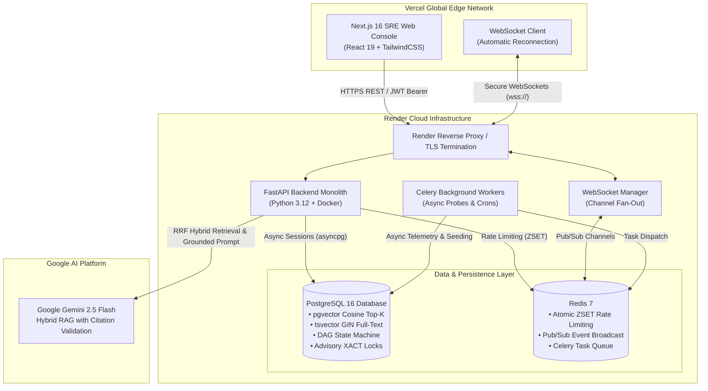

# Incident AIOps Platform — System Architecture

## 1. Problem Statement & Scope

Modern engineering teams need an enterprise-grade platform that converts noisy distributed service signals into actionable, mitigated incidents. Beyond standard CRUD interfaces, incident response requires rigorous consistency, deterministic alert deduplication, strict state transitions, auditability, high-throughput analytics, and grounded AI-driven root-cause mitigation that never hallucinates action items.

---

## 2. Production Cloud Architecture & Topology

The platform is deployed as a decoupled, resilient cloud architecture:
- **Frontend**: Hosted on **Vercel** with global Edge distribution (Next.js 16 App Router, React 19, TailwindCSS).
- **Backend API & Processing**: Containerized Docker application hosted on **Render** (FastAPI, Python 3.12, Uvicorn).
- **Relational & Vector Storage**: **Render Managed PostgreSQL 16** with `pgvector` support and PostgreSQL `tsvector` full-text search indexes.
- **Cache & Event Bus**: **Redis 7** (with sliding-window rate limiting, WebSocket pub/sub fan-out, and Celery task brokering; graceful in-memory `fakeredis` fallback when offline).
- **AI / RAG Pipeline**: **Google Gemini 2.5 Flash** (with fallback to semantic hash embeddings and contextual rule engine in air-gapped/offline modes).

---

## 3. Technology Stack & Decision Matrix

| Layer | Technology | Decision Rationale & Trade-Offs |
| :--- | :--- | :--- |
| **Frontend UI** | **Next.js 16 (App Router)** | Deployed to **Vercel** for instant Edge rendering, sub-100ms global static asset delivery, and automatic TypeScript compilation. Uses Lucide icons and Recharts for SRE telemetry visualization. |
| **Backend API** | **FastAPI (Python 3.12)** | Asynchronous native Python stack running in Docker on **Render**. Native Pydantic schema validation, OpenAPI / Swagger documentation generation, and high-concurrency async I/O. |
| **Database** | **PostgreSQL 16 + pgvector** | Unified relational and vector core. Avoids split-brain architectures by holding runbooks, logs, incidents, and 768-dim embeddings in a single ACID-compliant database. |
| **Event Bus & Cache** | **Redis 7** | Sub-millisecond sliding window rate limiting via atomic sorted sets (`ZSET`). Distributed WebSocket fan-out over pub/sub channels. Includes automatic `fakeredis` fallback. |
| **RAG & GenAI** | **Google Gemini 2.5 Flash** | High-speed structured analysis with strict JSON schema enforcement and programmatic 100% citation validation. Falls back to deterministic semantic heuristic engine when offline. |
| **Auth & Security** | **Argon2id + JWT (HS256)** | Password hashing via memory-hard Argon2id. Short-lived 15-minute access tokens and 14-day refresh token rotation. Role-based access control (`ADMIN`, `ENGINEER`, `ON_CALL_ENGINEER`, `VIEWER`). |

---

## 4. Bounded Domains

1. **Identity & Access Management (IAM)**:
   - User identities, roles, Argon2id passwords, and token issuance (`/api/v1/auth`).
2. **Services & Health Observability**:
   - Microservice catalog registry, availability SLOs, synthetic probe history, and status degradation tracking (`/api/v1/services`).
3. **Alert Ingestion & Deduplication**:
   - SHA-256 fingerprint generation based on title, service ID, and normalized metadata.
   - Atomic `INSERT ... ON CONFLICT (fingerprint) DO UPDATE` ensures alert storms increment occurrence counts without duplicate incidents (`/api/v1/alerts`).
4. **Incidents & DAG Lifecycle**:
   - Strict Directed Acyclic Graph (DAG) state machine:
     `DETECTED` → `TRIGGERED` → `ACKNOWLEDGED` → `INVESTIGATING` → `MITIGATING` → `RESOLVED` → `CLOSED`.
   - Concurrency control via PostgreSQL transaction advisory locks `pg_advisory_xact_lock(...)` and row locks `SELECT ... FOR UPDATE`.
5. **Log Telemetry & Redaction**:
   - Structured ingestion with automated regex redaction of API keys, bearer tokens, passwords, and secrets before disk storage (`/api/v1/logs`).
6. **Knowledge Base & Hybrid RAG**:
   - SRE runbooks, architectural decision records (ADRs), and postmortems stored in `knowledge_chunks` with full-text search (`tsvector`) and vector embeddings (`vector(768)`).
   - Reciprocal Rank Fusion ($k=60$) merges keyword and semantic rankings.
7. **Pure SQL Analytics Engine**:
   - Real-time MTTA/MTTR calculations using `FILTER` clauses and `PERCENTILE_CONT(0.5 / 0.95) WITHIN GROUP` for P50 and P95 latency distributions.

---

## 5. Security & Network Architecture

- **Cross-Origin Resource Sharing (CORS)**: Configured dynamically via `CORS_ORIGINS`. Allows secure requests from the Vercel production domain (`https://incident-aiops-frontend.vercel.app`) and local development environments.
- **WebSocket Protocol Negotiation**: Front-end automatically negotiates `ws://` (local) to `wss://` (production TLS), routed through Render's TLS termination proxy.
- **Credential Isolation**: No database passwords, JWT secrets, or Gemini API keys are accessible to the client or baked into the frontend build. Frontend only receives the public API endpoint via `NEXT_PUBLIC_API_BASE_URL`.
