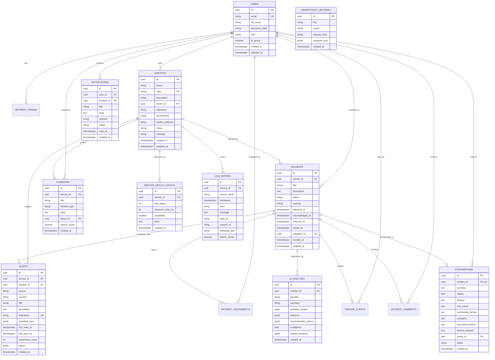

# PostgreSQL Database Schema & Entity-Relationship Architecture

This document describes the unified single-database relational schema for the **Incident Management & AIOps Platform**, powered by **PostgreSQL 16** and **SQLAlchemy 2.0 Async (asyncpg)**.

---

## 1. Entity-Relationship (ER) Diagram

---

## 2. Relational Tables & Hardened Schema Details

### 2.1 Core Tables

1. **`users`**:
   - `id` (UUID PK): Unique identifier.
   - `email` (VARCHAR(320) UNIQUE): Case-normalized email index.
   - `role` (ENUM): `ADMIN`, `ENGINEER`, `ON_CALL_ENGINEER`, `VIEWER`.
   - `password_hash` (VARCHAR(500)): Argon2id derived hash.

2. **`services`**:
   - `slug` (VARCHAR(180) UNIQUE): URL-safe identifier.
   - `criticality` (ENUM): `LOW`, `MEDIUM`, `HIGH`, `CRITICAL`.
   - `status` (ENUM): `HEALTHY`, `DEGRADED`, `DOWN`, `UNKNOWN`.

3. **`service_health_checks`**:
   - Stores time-series synthetic probe results.
   - CHECK constraints:
     - `ck_service_health_status_code`: `http_status IS NULL OR (http_status >= 100 AND http_status <= 599)`
     - `ck_service_health_latency_nonneg`: `response_time_ms IS NULL OR response_time_ms >= 0`
   - Index: `(service_id, created_at DESC)` for latency window queries.

4. **`incidents`**:
   - State Machine: `DETECTED` $\to$ `TRIGGERED` $\to$ `ACKNOWLEDGED` $\to$ `INVESTIGATING` $\to$ `MITIGATING` $\to$ `RESOLVED` $\to$ `CLOSED`.
   - Severity: `SEV1`, `SEV2`, `SEV3`, `SEV4`.
   - CHECK constraints:
     - `ck_incidents_ack_after_created`: `acknowledged_at IS NULL OR acknowledged_at >= created_at`
     - `ck_incidents_res_after_created`: `resolved_at IS NULL OR resolved_at >= created_at`
   - **Partial Index**:
     - `ix_incidents_open_per_service` on `(service_id)` WHERE `status IN ('DETECTED', 'TRIGGERED', 'ACKNOWLEDGED', 'INVESTIGATING', 'MITIGATING')`.
     - Optimizes open-incident correlation queries by omitting historical resolved/closed incidents.

5. **`alerts`**:
   - Server-Side Fingerprint: SHA-256 of normalized `(service_id, title, labels)`.
   - Unique Constraint: `uq_alerts_fingerprint` collapses concurrent identical alert bursts into an atomic counter increment (`occurrence_count += 1`).
   - CHECK constraints:
     - `ck_alerts_occurrence_count_positive`: `occurrence_count >= 1`
     - `ck_alerts_last_seen_after_first`: `last_seen >= first_seen`
   - **GIN Index**:
     - `ix_alerts_metadata_json_gin` on `metadata_json` using PostgreSQL GIN for arbitrary label containment queries (`metadata_json @> '{"cluster": "prod-1"}'`).

6. **`log_entries`**:
   - High-throughput operational log repository.
   - **Generated Full-Text Search Vector**:
     - Column `search_vector tsvector GENERATED ALWAYS AS (to_tsvector('english', coalesce(message, ''))) STORED`.
   - **GIN Index**:
     - `ix_log_entries_search_vector_gin` on `search_vector` using GIN.
     - `ix_log_entries_metadata_json_gin` on `metadata_json` using GIN.
   - B-Tree Composite Index: `(service_id, timestamp DESC)` for fast windowed retrieval during incident detection.

7. **`runbooks`**:
   - Standard Operating Procedures (SOPs) library.
   - **Generated Full-Text Search Vector**:
     - Column `search_vector tsvector GENERATED ALWAYS AS (to_tsvector('english', coalesce(title, '') || ' ' || coalesce(body, ''))) STORED`.
   - **GIN Index**:
     - `ix_runbooks_search_vector_gin` on `search_vector` using GIN.

8. **`postmortems`**:
   - `incident_id` (UUID UNIQUE FK): Strict 1-to-1 relationship with incidents.
   - Captures 5-whys root causes, contributing factors, resolution, and preventive action items.

9. **`ai_analyses`**:
   - Stores LLM/heuristic root cause diagnoses, hypothesis rankings, evidence items, and calculated confidence scores.

10. **`idempotency_records`**:
    - Stores `(key, scope)` unique pairs to ensure safe HTTP retry replay without duplicate side-effects.

---

## 3. Migration History

| Version | Migration Identifier | Purpose |
|---|---|---|
| `0001` | `0001_initial_schema` | Baseline schema: tables, enums, foreign keys, base indexes. |
| `0002` | `0002_schema_hardening` | Hardening: CHECK constraints, GIN indexes (JSONB & tsvector), partial open-incident index, server-side alert timestamps (`first_seen_at`, `last_seen_at`). |
